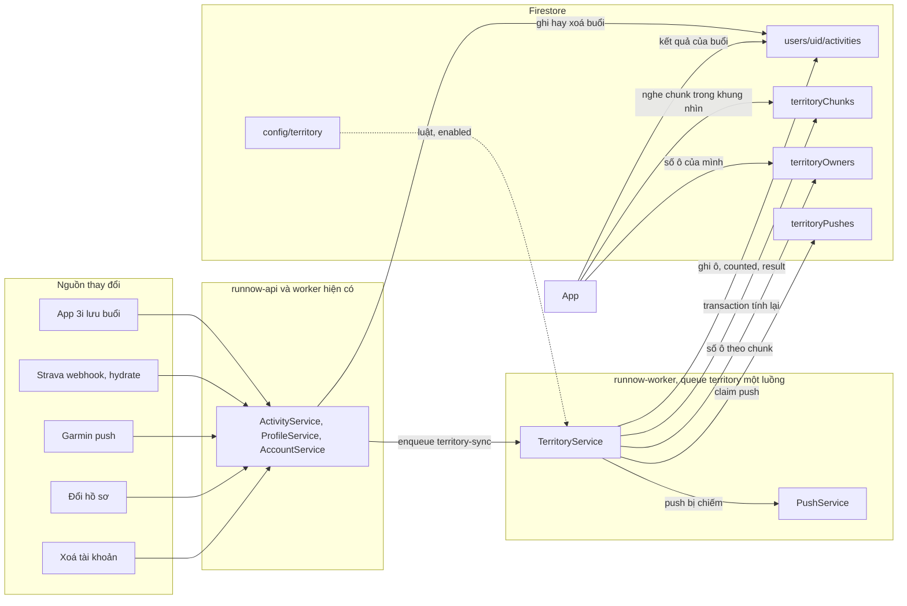
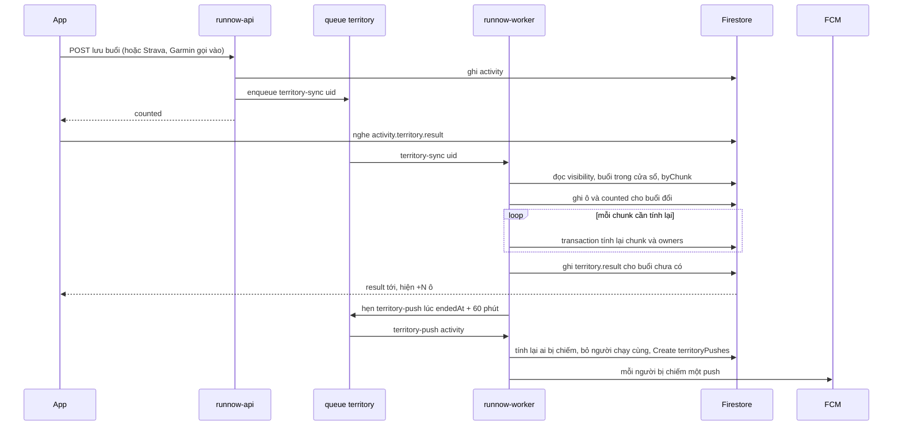

# Lãnh địa chạy bộ — thiết kế

> Chạy qua ô bản đồ nào thì có phần ở ô đó. Ai chạy nhiều km nhất trong ô trong 30 ngày gần nhất thì giữ ô.
>
> Phạm vi: backend Go (api, worker), app Flutter, web Flutter · Trạng thái: **chờ duyệt** (đã qua 3 vòng review độc lập, vòng cuối không còn lỗi chặn) · 2026-11-25
> Dòng code trích theo `feat/rank-reward-draw` (c5d9b43 backend, 38b4bee app) · Tham chiếu: [`backend_architecture.md`](backend_architecture.md), số đo ở [`features/lanh-dia-2026-11/probe/`](../features/lanh-dia-2026-11/probe/)

## 1. Mục tiêu

Lãnh địa cho người chạy một lý do để ra đường, chạy tuyến mới và chạy lại tuyến cũ: ô của mình hiện trên bản đồ, người khác chạy qua thì mất ô và nhận push. Backend tính toàn bộ ô và chủ ô từ các buổi chạy đã lưu; app chỉ đọc và vẽ. Đánh đổi lớn nhất: với lượng người chạy hiện tại, tranh chấp chỉ khoảng **1 push mỗi tuần cho cả club** (mục 6.1), nên bản đầu sẽ có giá trị chủ yếu là "bản đồ những nơi mình đã chạy". Tranh chấp chỉ dày lên khi có thêm người chạy cùng khu.

### Vì sao làm lúc này

Quà BXH (app 1.18.0+37) đã ra. Map vector tự host (Protomaps qua `mapBaseLayer`) đã chạy ở mọi màn có bản đồ, nên vẽ lớp ô lên trên không tốn thêm hạ tầng.

### Đích đến

- Lưu buổi chạy xong, trong vài giây người chạy thấy "+N ô" ở màn kết thúc và màn chi tiết buổi.
- Mở màn Lãnh địa thì thấy ô của mình và của mọi người trên bản đồ, lọc được theo từng người, ô càng nhiều km càng đậm.
- Bị chiếm ô thì nhận một push, chạm vào mở đúng vùng đó.
- Khoe được một thẻ ảnh lãnh địa.
- Đổi luật (số ngày giữ ô, môn tính, ngưỡng chống gian) chỉ cần sửa backend, không bắt update app.

### Phạm vi không làm

- Chơi theo phe hay đội. Bản đầu tính theo từng người.
- Chiếm vùng bằng vòng khép kín.
- BXH lãnh địa có quà: làm ở đợt sau, dùng lại rank close và `rankRewards` (mục 6.4).
- Tính ô cho buổi không có tuyến GPS (Apple Health, Health Connect, Strava manual).
- Đi bộ ghi bằng app 3i hay Garmin (mục 2, Ai được tính).
- Trang web công khai cho người chưa đăng nhập xem lãnh địa của một người.
- Đạp xe.

### Thuật ngữ

| Từ | Nghĩa |
|---|---|
| ô | Một tile bản đồ ở zoom 18 theo lưới slippy map (`z18/x/y`). Cạnh ô khoảng 150 m ở TP.HCM |
| chunk | Một tile zoom 13, gom 32×32 = 1024 ô. Đơn vị lưu và đơn vị app tải về |
| lượt qua | Một buổi được tính đi qua một ô, ghi bằng khoá `(endedAt, uid, activityId)` và số mét chạy trong ô |
| km trong ô | Tổng mét các lượt qua của một người ở một ô, chỉ tính lượt có `endedAt` trong 30 ngày gần nhất |
| chủ ô | Người có km trong ô lớn nhất. Ô không còn lượt qua nào trong 30 ngày thì trống |

## 2. Phương án thiết kế chung

### Lưới ô

**Ô là tile slippy map z18.** Go và Dart cùng tính được id ô từ lat/lng bằng một công thức, không cần thư viện. Ô trùng lưới với tile bản đồ, nên app vẽ ô bằng bốn góc tile.

| Cạnh | Ô/buổi (trung vị · p90) | Lượt chiếm/tuần (luật người qua gần nhất) | Được | Mất |
|---|---|---|---|---|
| z17, ~300 m | 2 · 15 | 6,3 | Ít dữ liệu | Một ô lớn hơn block phố; chạy 3 km chỉ được vài ô |
| **z18, ~150 m** | **5 · 34** | **10,4** | Cỡ một block phố HCM, ô theo kịp tuyến | — |
| z19, ~75 m | 9 · 71 | 24,5 | Nhiều ô hơn, số to hơn | Sai số GPS 10–30 m làm tuyến lấn sang ô bên cạnh; dữ liệu gấp đôi |

Số đo trên 152 buổi official có tuyến trong 90 ngày tới 2026-11-25 (mục 6.1). Số push không đổi giữa ba cỡ ô (33–34 trong 90 ngày), vì push đếm theo người theo buổi. Vậy cỡ ô chỉ đổi cảm giác "nhiều ô", không đổi độ tranh chấp.

Cỡ ô là quyết định **không quay lại được** sau khi ra mắt: đổi cỡ thì mọi id ô đã lưu mất nghĩa. Luật khác đều nằm trong config.

### Lấy ô từ tuyến

**Tuyến lấy từ nguồn giàu dữ liệu nhất của lần chạy.** Thứ tự ưu tiên:

1. `routePoints` của chính buổi. Buổi app 3i và Garmin luôn có; buổi Strava có sau khi hydrate (tối đa 500 điểm, có thời gian, `normalizeStreams` trong `activity_service.go`).
2. `routePoints` của bản trùng: doc 3i hay Garmin có `duplicateOfActivityId` trỏ về buổi Strava official.
3. `polyline` của buổi Strava: không có thời gian.

Buổi ghi `territory.routeFrom` là id doc đã cho tuyến.

Backend lọc tuyến trước, rồi mới cắt đầu cuối trên tuyến đã lọc:

1. Bỏ điểm có `accuracyMeters` trên 30 m. Điểm không có field này (Garmin, bản ghi cũ) thì giữ.
2. Bỏ đoạn giữa hai điểm dài hơn 2 km (mất tín hiệu, nhảy GPS).
3. Tuyến có thời gian thì bỏ đoạn nhanh hơn 2:30/km (đi xe) và đoạn chậm hơn 20:00/km (đứng chờ đèn, ngồi quán mà app vẫn ghi). Với luật km, điểm GPS nhảy vài mét mỗi giây lúc đứng yên sẽ cộng thành hàng trăm mét trong một ô, nên lọc này quyết định ai giữ ô.
4. Cắt 200 m đầu và 200 m cuối theo quãng đường cộng dồn trên tuyến đã lọc. Làm sau bước 1–3 để quãng GPS nhảy lúc đứng ở cửa nhà không "ăn" hết 200 m.
5. Nội suy mỗi 10 m rồi cộng số mét vào từng ô, để đoạn thẳng dài giữa hai điểm thưa không nhảy cóc qua ô.

Ô và số mét ghi lên chính doc buổi chạy. Tính lại chunk về sau chỉ đọc field này. Mọi query đều dùng projection (`Select`) chỉ lấy field `territory`, không đọc `routePoints` (doc buổi tới 800 KB). Ô được tính lại khi `territory.inputHash` khác giá trị mới, tức khi một trong các đầu vào đổi: `config/territory.version`, `startedAt`, `elapsedTimeSeconds`, `routeFrom`, và `routeSavedAt` của doc `routeFrom`. `routeSavedAt` là field mới: mọi đường ghi `routePoints` (lưu buổi 3i, hydrate Strava, chi tiết Garmin) ghi thêm mốc này. Garmin có thể gửi tóm tắt trước, chi tiết sau, nên thiếu mốc này thì buổi Garmin không bao giờ có ô. Không dùng `updatedAt`, vì chính lần ghi `territory` cũng làm nó đổi. Các field này đều vô hướng, đọc được bằng projection. Vì vậy buổi Strava bị cắt bớt, buổi vừa hydrate, buổi vừa có bản trùng đều được tính lại ô.

Webhook Strava chỉ ghi lại buổi khi `SummaryChanged` (`activity_mapper.go:65`), mà hydrate (ghi `routePoints`) không enqueue gì. Thay đổi kèm theo: hydrate xong thì enqueue `territory-sync`.

### Ai giữ ô

**Chủ ô là người có km trong ô lớn nhất, chỉ tính các lượt qua có `endedAt` trong 30 ngày tính tới thời điểm xét.** Hoà thì người có lượt qua ô sớm hơn trong cửa sổ giữ, tức người tới trước. User chọn luật này ngày 2026-11-25, thay cho luật "người qua gần nhất" chọn trước đó.

| Luật giữ ô (ô z18, 30 ngày) | Lượt chiếm/tuần | Push/tuần, cả club | Được | Mất |
|---|---|---|---|---|
| **Nhiều km trong ô nhất (chọn)** | 2,7 | 1,0 | Thưởng người chạy đều ở một khu. Chạy ngang một lần không lấy được ô của người chạy ở đó hằng ngày. Người chạy vòng trong khu nhỏ giữ chắc ô của mình | Ít chuyện để push. Ai muốn chiếm phải chạy thêm km thật ở ô đó |
| Người qua gần nhất | 10,4 | 2,6 | Một câu là hiểu, nhiều push | 31/133 lượt chiếm là do hai người chạy cùng nhau, ai về sau thì "chiếm" của người kia. Chạy ngang một lần là lấy được ô |
| Nhiều lần qua nhất | 0,9 | 0,3 | Dễ đếm | Hay hoà 1–1, mà hoà thì người đến trước giữ ô, nên gần như không ai mất ô |

Hai người chạy cùng nhau thường có km trong ô gần bằng nhau, nhưng hiếm khi bằng hẳn do sai số GPS. Vì vậy vẫn có ô đổi chủ giữa họ: đo được 9/35 lượt chiếm và 4/13 push theo luật này. Ô vẫn đổi chủ theo km như luật, nhưng backend không gửi push "bị chiếm" cho người có buổi kết thúc cách buổi chiếm không quá 3 giờ (`config/territory.quietCoRunHours`, mục 4). Push còn khoảng 9 trong 13 tuần, tức 0,7/tuần. Số này đo theo điều kiện một chiều (chủ cũ qua ô trong 3 giờ trước), chưa đo với điều kiện hai chiều.

**Hàm thuần.** `owner(lượt, T)`: với một ô, cộng mét theo từng người của các lượt có `endedAt` trong `(T - decayDays, T]`. Chủ là người có tổng lớn nhất. Hoà thì so lượt sớm nhất của mỗi người trong cửa sổ, trùng nữa thì so `uid`. Hàm không đọc gì từ chunk đã lưu, nên cùng một tập lượt và cùng `T` luôn ra cùng một chủ. Chunk lưu kết quả của hàm với `T = now`: `u` (chủ), `m` (km của chủ), `m2` (km của người thứ hai). Ô không còn lượt nào trong cửa sổ thì bị bỏ khỏi chunk.

Chủ ô có thể đổi mà không có buổi mới nào: km của chủ trôi khỏi cửa sổ 30 ngày, người thứ hai thành chủ. Lần tính lại hằng ngày ghi đổi chủ này. Không buổi nào được tính là đã chiếm, và không ai nhận push, vì không ai vừa chạy để chiếm.

App hiện "Chủ ô: tên · km" từ `u` và `m`. App chỉ đọc số backend tính, không tự áp luật.

Được: buổi tới trễ, task chạy lại, buổi bị xoá hay bị đánh trùng, người chuyển private đều sửa được bằng cách tính lại. Mất: mỗi lần tính lại một chunk phải query lại mọi buổi chạm chunk trong cửa sổ (mục 3, index). Mỗi buổi phải lưu số mét trong từng ô (mục 3, lược đồ).

Đổi sang luật khác về sau chỉ là sửa hàm này rồi tính lại, app không đổi.

### Ai được tính

**Chỉ tính buổi official theo `SelectOfficialActivities` (`derived_data_service.go:140`).** Lãnh địa dùng chung đúng luật chọn buổi của BXH km, nên một lần chạy có cả bản 3i và bản Strava chỉ được tính một lần, và hai tính năng không lệch nhau. Mất: luật đó nhận Run, TrailRun, VirtualRun, Walk, Hike từ Strava, nhưng chỉ nhận `Run` từ ≥ 500 m với nguồn khác. Vì vậy buổi đi bộ ghi bằng 3i hay Garmin không có ô. Muốn tính chúng thì phải sửa luật chọn buổi của cả BXH. Thay đổi đó làm ngoài tính năng này.

**Chỉ tính người có hồ sơ public.** Rules chỉ cho người khác đọc buổi chạy khi `publicProfiles/{uid}.profileVisibility == 'public'` (`firestore.rules:13-16`, `28-29`). Nếu tính cả hồ sơ private thì bản đồ ô sẽ lộ tuyến của người đã chọn ẩn. Đo ngày 2026-11-25: cả 17 người có tuyến đều public, nên luật này hiện không loại ai. Người private mở màn Lãnh địa sẽ thấy lời mời bật hồ sơ công khai.

### Ghi theo chunk

**Chủ ô lưu theo chunk z13, không lưu mỗi ô một doc.** App nghe vài chunk trong khung nhìn thay vì hàng nghìn doc ô. Một chunk có tối đa 1024 ô, mỗi ô khoảng 70 byte, tức khoảng 70 KB, dưới trần 1 MB. Đo 90 ngày: nhiều nhất 2 buổi cùng chunk kết thúc trong cùng 60 giây, 6 lần như vậy.

### Một hàng đợi, một đường ghi

**Mọi việc của lãnh địa chạy trên một queue Cloud Tasks riêng tên `territory`, `maxConcurrentDispatches = 1`.** Các task là `territory-sync`, `territory-rebuild`, `territory-push` và việc hằng ngày. Mỗi lúc chỉ một task chạy, nên hai lần sync của cùng một người không ghi đè nhau, và không cần cờ đánh dấu "còn phải tính lại". Backfill (`migrations/territory-backfill`) chạy `Sync` lần lượt cho từng người từ máy người vận hành, và từ chối chạy khi `enabled` hay `enabledAt` đã đặt. Trước khi bật, mọi kết quả còn rỗng và không có push, nên chạy song song với queue vẫn an toàn; chunk đúng nhờ transaction.

Được: bỏ hẳn lớp lập luận về khoá và xen kẽ giữa các task. Mất: các task xếp hàng. Mỗi sync mất vài giây. Ở mức 100 lần dữ liệu (170 buổi/ngày) queue bận dưới 1% thời gian, trừ việc hằng ngày (mục 5, dung lượng). Phải thêm queue vào `tasks.go` và hạ tầng. Queue đặt `--min-backoff 10s --max-backoff 600s --max-attempts -1`. Mặc định của `ensure_queue` hiện nay (`deploy.sh`, 8 lần thử với backoff mặc định) có thể bỏ task chỉ sau một lần deploy worker. `dispatchDeadline` phải lớn hơn hoặc bằng timeout của worker trên Cloud Run, và handler dùng `ctx` của request, để task bị cắt thì dừng hẳn chứ không chạy song song với bản giao lại.

Cloud Tasks giao task ít nhất một lần. Một task chạy quá `dispatchDeadline` thì có thể bị giao lại trong lúc bản cũ còn chạy. Sync chỉ mất vài giây, xa mức 10 phút mặc định, nên ca này rất hiếm. Để chunk vẫn đúng trong ca đó, mỗi lần tính lại chunk vẫn nằm trong transaction (đọc chunk rồi ghi chunk). Ghi `counted` lệch trong ca này được sửa ở lần sync hằng ngày của người đó.

**Mọi thay đổi chủ ô đi qua một thao tác: tính lại cả chunk bằng hàm `owner` với `T = now`.** Không có đường "áp tăng dần" riêng. Mỗi lần sync của người U tính lại mọi chunk U đang có ô (khoá của `territoryOwners/{U}.byChunk`), cộng mọi chunk các buổi của U trong cửa sổ chạm tới, cộng chunk cũ của buổi vừa đổi ô. Buổi bị xoá không còn trong danh sách buổi. Nếu U đang giữ ô ở chunk của buổi đó thì chunk nằm trong `byChunk`, nên vẫn được tính lại. Nếu U không giữ ô nào ở đó thì bỏ buổi chỉ làm đổi `m2`, và lần tính lại hằng ngày sẽ sửa.

### Kết quả của một buổi

**"+N ô" là sự kiện, nên tính theo thời điểm của chính buổi, không suy từ chunk.** Với buổi X của người B, ở từng ô của X:

- `trước` = `owner(các lượt có khoá nhỏ hơn X, X.endedAt)`.
- `sau` = `owner(các lượt có khoá nhỏ hơn X, cộng X, X.endedAt)`.
- `sau` là B mà `trước` trống: ô mới, tính vào `gained`.
- `sau` là B mà `trước` là người V khác B: X chiếm ô của V, tính vào `taken[V]`.

Khoá là `(endedAt, uid, activityId)`. Chủ chạy lại tuyến cũ thì `trước` đã là chủ, nên không có ô mới. Hai buổi của cùng một người: buổi sau so với trạng thái đã có buổi trước, nên không đếm đôi.

Kết quả tính một lần, so với **các buổi đã về lúc xử lý**, rồi ghi `territory.result`. Buổi về trễ có thể làm kết quả đã ghi của buổi khác thành sai. Ví dụ: B chạy lúc 7h nhưng Garmin lưu lúc 10h, C chạy lúc 8h và lưu ngay. Khi đó `result` của C ghi là chiếm ô của A, dù đúng ra là của B. `result` chỉ dùng để hiện "+N ô", nên cái sai dừng ở con số đó. Push không đọc `result` mà tính lại lúc gửi (mục 4).

Ghi `result` chỉ khi chưa có. Firestore không có precondition kiểu "field chưa có", nên đây là kiểm trong code; queue một luồng làm việc kiểm này đủ. `counted` đổi từ false sang true thì xoá `result`, để lần sync đó tính lại.

### Màn Lãnh địa

**Màn Lãnh địa là chỗ xem lãnh địa của mình và của mọi người.** Trên bản đồ có hàng lọc Tất cả · Của tôi · Mọi người. Mọi người mở danh sách người đang giữ ô, nhiều ô trước, bằng nhau thì theo `uid` để thứ tự không nhảy. Chọn một người thì bản đồ chỉ vẽ ô của người đó. Màn hình không có ô nào của họ thì bản đồ fit vào các ô họ giữ ở chunk nhiều ô nhất; đang thấy ô của họ thì giữ chỗ xem. Người dùng đổi lọc hay tự kéo bản đồ trong lúc chờ đọc ô thì bản đồ không bị kéo đi.

**Ô đậm theo `m`**, tức số mét chủ ô chạy trong ô trong cửa sổ giữ ô. Có bốn mức, ngưỡng 300, 750 và 1500 m, tương đương khoảng 2, 5 và 10 lượt qua ô (mỗi lượt khoảng 150 m). Đây cũng là số dùng để xét ai giữ ô, nên ô càng đậm thì người khác càng phải chạy nhiều mới chiếm được. Chạm ô thì thấy tên chủ và km.

| Được | Mất |
|---|---|
| Không đổi backend, không tính lại dữ liệu: `m` đã có trong chunk | Một buổi chạy vòng nhiều lần trong một ô cũng làm ô đậm, chứ không đếm số buổi |
| Danh sách Mọi người đọc thẳng `territoryOwners`, rules đã cho đọc | Mỗi lần tải đọc mọi doc owners, kể cả doc rỗng (lọc ở app). App giữ danh sách 5 phút sau lần đọc thành công |

### Phương án đã cân nhắc và loại

| Phương án | Lý do loại |
|---|---|
| App tự tính ô rồi gửi lên | Đổi luật phải update app; app bị sửa thì gửi ô giả được |
| Ô lục giác H3 | Thư viện Go của H3 cần cgo, làm build image phức tạp thêm; Dart phải thêm thư viện. Ô vuông theo tile đủ dùng |
| Mỗi ô một doc | App phải nghe hàng nghìn doc; tốn lượt đọc gấp vài trăm lần chunk |
| Áp tăng dần làm đường chính, tính lại khi cần | Hai đường giữ cùng một luật và lệch nhau ở mép cửa sổ. Kết quả dựa vào phần chênh nên sai khi task chạy lại giữa chừng |
| Suy kết quả của buổi từ chunk đã lưu | Hai buổi mới của cùng một người trong một lần tính lại thì bị đếm đôi hoặc mất |
| Độ đậm theo số buổi qua ô | Backend phải ghi thêm field cho mỗi ô và tính lại mọi chunk. Km đã nói đúng điều người xem cần: ô này khó chiếm tới đâu |
| Task song song, chống xen kẽ bằng cờ `pendingChunks` và field trên tombstone | Cờ mất ở nhiều đường: ghi đè, xoá lẫn của task khác, `deleteActivity` đọc buổi ngoài transaction, `fetchAndUpsert` xoá tombstone. Hàng đợi một luồng gọn hơn và rẻ ở quy mô này |

## 3. Kiến trúc và thay đổi

### Trách nhiệm

| Thành phần | Làm | Không làm |
|---|---|---|
| `ActivityService` | Ghi và xoá buổi như hiện tại. Enqueue `territory-sync` ở cùng chỗ `enqueueDerived`, và sau khi hydrate buổi Strava | Không tính ô, để request lưu buổi không chậm thêm |
| `ProfileService.Update` | Enqueue `territory-sync`, TaskID kèm thời điểm | |
| `AccountService.Delete` | Đọc chunk của người đó, enqueue tính lại sau khi xoá cây `users/uid`, xoá `territoryOwners/{uid}` sau cùng | |
| `TerritoryService` (worker) | Đối chiếu buổi của một người, tính ô, tính lại chunk, ghi kết quả, gửi push | Không đọc hay ghi BXH km |
| Việc hằng ngày (từ `refresh-leaderboard` có sẵn) | Sync lại mọi member, tính lại mọi chunk, xoá doc owners rỗng | |
| App | Đọc chunk, owners, kết quả trên buổi; vẽ ô; hiện chủ ô và km của chủ từ `u`, `m` | Không tính ô, không quyết định ai giữ ô |

### Chỗ phải sửa

| Chỗ | Thay đổi | Mức |
|---|---|---|
| `tasks.go` và hạ tầng queue | Thêm queue `territory`, `maxConcurrentDispatches = 1` | Nhỏ |
| `activity_service.go` `enqueueDerived` | Publish thêm `territory-sync` vào queue `territory`, cùng `cause`. Webhook Strava chỉ tới đây khi `SummaryChanged` | Nhỏ |
| `activity_service.go` `fetchAndUpsert` (nhánh hydrate) | Enqueue `territory-sync` sau khi ghi `routePoints` | Nhỏ |
| Mọi chỗ ghi `routePoints`: `SaveTracked`, hydrate Strava, `store` của Garmin (`garmin_service.go`) | Ghi thêm `routeSavedAt = ServerTimestamp` | Nhỏ |
| `profile_service.go` `Update` | Publish thêm `territory-sync`, TaskID kèm thời điểm như `enqueuePeriodStatsBatch`, để đổi qua lại nhiều lần trong một giờ không bị Cloud Tasks gộp mất | Nhỏ |
| `account_service.go` `Delete` | Đọc khoá `byChunk` ở đầu; enqueue `territory-rebuild` sau `deleteDocumentTree(users/uid)`; xoá `territoryOwners/{uid}` sau cùng | Nhỏ |
| `territory*.go` (mới) | Lưới ô, lấy ô từ tuyến, `owner`, tính lại chunk, kết quả, các task | Lớn |
| `push_prefs.go` `pushGroups`, `Prefs` | Thêm nhóm `territory` ("Lãnh địa: bị chiếm ô"); `Prefs` chỉ trả nhóm này khi `config/territory.enabled` | Nhỏ |
| `http_server.go` `rebuild-derived-data` và `refresh-leaderboard` | Cuối `rebuild-derived-data` enqueue `territory-sync`. Mọi đường lưu, xoá buổi và đổi hồ sơ đã đi qua task này, và `refresh-leaderboard` chạy nó cho mọi member mỗi ngày, nên một chỗ móc là đủ. `refresh-leaderboard` enqueue thêm `territory-daily`, TaskID theo ngày | Nhỏ |
| `migrations/territory-backfill` (mới) | Chạy `Sync` cho mọi user, không hẹn push | Nhỏ |
| `firestore.rules` | `territoryChunks`, `territoryOwners`, `config/territory`: đọc khi đăng nhập, app không ghi. App lấy cờ bật từ `config/territory.enabled`, không dùng Remote Config riêng, để ra mắt chỉ bật một chỗ và bản web cũng theo được. `territoryPushes`: không ai đọc từ app | Nhỏ |
| `firestore.indexes.json` | Index collection group `activities`: `territory.counted` ==, `territory.chunks` array-contains, `territory.endedAt` range. Field override tắt index tự động cho `territoryChunks.cells` và `territory.cells` (collection group `activities`). TTL cho `territoryPushes.expireAt` | Nhỏ |
| `lib/src/territory/` (mới) | Repository nghe chunk theo khung nhìn, màn Lãnh địa, lớp ô trên `mapBaseLayer` đậm theo `m`, hàng lọc, danh sách người giữ ô đọc từ `territoryOwners` | Lớn |
| Màn kết thúc buổi, chi tiết buổi, Trang chủ | Dòng "+N ô" và "Lãnh địa N ô" | Vừa |
| `lib/src/push.dart` `pushLocation` | `kind == 'territory_taken'` mở `/lanh-dia?chunk=…` | Nhỏ |
| Thẻ khoe (`card_share`) | Thẻ lãnh địa | Vừa |

`deleteActivity` không phải sửa: nó đã enqueue qua `enqueueDerived`, và sync tính lại chunk từ `byChunk`.

### Lược đồ dữ liệu

**Trên buổi chạy**, ở `users/{uid}/activities/{id}.territory`, chỉ backend ghi, luôn bằng `Update` (doc đã bị xoá thì `NotFound`, task bỏ buổi đó, không dựng lại doc):

| Field | Kiểu | Nghĩa |
|---|---|---|
| `inputHash` | string | Hash các đầu vào của ô (mục 2). Khác thì tính lại ô |
| `cells` | map `x_y` → int | Ô z18 của buổi và số mét chạy trong ô |
| `chunks` | array string | Id chunk `x_y` ở z13 mà `cells` rơi vào |
| `endedAt` | timestamp | `startedAt + elapsedTimeSeconds` |
| `counted` | bool | Buổi đang official và chủ buổi đang public |
| `routeFrom` | string | Id doc đã cho tuyến |
| `result` | map | `gained`, `taken` (map uid → số ô). So với các buổi đã về lúc xử lý (mục 2). Chỉ để hiện "+N ô". Buổi không được tính, và buổi cũ lúc backfill, có `result` rỗng |

Buổi 5 km thường có khoảng 35 ô, mỗi mục khoảng 20 byte, nên `cells` thêm dưới 1 KB vào doc.

**`territoryChunks/{x_y}`** (z13), chỉ backend ghi: `cells` là map `x_y` → `{u, m, m2}`. Trong đó `u` là chủ ô, `m` là km trong ô của chủ (mét), `m2` là km của người thứ hai. Thêm `updatedAt`.

**`territoryOwners/{uid}`**, chỉ backend ghi: `byChunk` (map chunk → số ô người này giữ trong chunk) và `updatedAt`. Mỗi lần tính lại chunk ghi đè mục `byChunk.{chunk}` của từng người có ô trước hoặc sau lần tính, về 0 thì xoá mục. Ghi đè chứ không cộng dồn, nên chạy lại không lệch số. App cộng các mục để ra tổng; danh sách Mọi người đọc cả collection và bỏ doc rỗng. Tên và avatar đọc từ `leaderboardEntries`. Lần tính lại chạy sau khi owners đã bị xoá có thể tạo lại một doc rỗng chỉ có `updatedAt`, không có dữ liệu cá nhân; việc hằng ngày xoá nó.

**`territoryResults/{uid}_{activityId}`**, chỉ backend ghi, người đăng nhập đọc: bản nhỏ của `territory.result` (`gained`, `taken`, `chunk` là chunk đầu của buổi để mở bản đồ đúng vùng). App nghe doc này thay vì nghe doc buổi tới 800 KB. Backend ghi nó trước dấu `territory.result`; xoá tài khoản xoá theo `uid`.

**`territoryPushes/{uid}_{activityId}`**, chỉ backend: claim một lần cho push, tạo bằng `Create` (đã có thì thất bại), `expireAt` sau 30 ngày cho TTL. Doc riêng để claim không bao giờ dựng lại doc buổi đã xoá; `claimOnce` hiện có (`notify_dedup.go`) làm việc đó khi gặp `NotFound`.

**`config/territory`**, chỉ backend ghi: `enabled` (false tới khi ra mắt), `enabledAt` (mốc bật; buổi kết thúc trước mốc này không có kết quả và không push), `version`, `decayDays` (30), `trimMeters` (200), `fastestPaceSecPerKm` (150), `slowestPaceSecPerKm` (1200), `maxAccuracyMeters` (30), `quietCoRunHours` (3), `pushDelayMinutes` (60).

## 4. Các luồng xử lý

### Lưu buổi chạy tới lúc thấy "+N ô"

### `territory-sync` của người U

1. Đọc `publicProfiles/{U}`, `territoryOwners/{U}`, các buổi của U có `startedAt` trong cửa sổ cộng hai ngày (projection, không đọc `routePoints`), rồi lọc theo `endedAt`. Buổi dài hơn hai ngày bị bỏ. Chọn official bằng `SelectOfficialActivities`.
2. Với buổi có `inputHash` khác: đọc tuyến, tính ô, ghi `cells`, `chunks`, `endedAt`, `routeFrom`, `inputHash`. Ghi `counted` = official và public. `counted` đổi từ false sang true thì xoá `result` cùng lần.
3. Chunk cần tính lại: khoá của `byChunk`, `chunks` của mọi buổi đọc ở bước 1, chunk cũ của buổi vừa đổi ô ở bước 2.
4. Tính lại từng chunk.
5. Với buổi chưa có `result`: buổi không được tính, hoặc có `endedAt < config/territory.enabledAt` (hay `enabledAt` chưa đặt), thì ghi `result` rỗng. Buổi còn lại thì tính kết quả (mục 2) rồi ghi.
6. Nếu `enabled`: với buổi `counted` có `endedAt ≥ enabledAt`, kết thúc trong 24 giờ, mà `result` có ít nhất một ô (`gained` hoặc `taken`): enqueue `territory-push`. Xét cả `gained` vì một buổi về trễ của người khác có thể biến ô "mới" thành ô chiếm được, và push tính lại lúc gửi. Hẹn lúc `endedAt + pushDelayMinutes`, hoặc ngay nếu đã quá giờ đó. TaskID cố định theo buổi.

Task chết ở bất kỳ bước nào thì Cloud Tasks chạy lại từ bước 1. Bước 3 không dựa vào dấu nào của lần chạy trước, nên không có gì bị bỏ sót. Riêng chunk cũ của buổi đổi ô mà task chết sau bước 2: nếu U giữ ô ở đó thì chunk nằm trong `byChunk`. Nếu không thì chỉ `m2` lệch, tới việc hằng ngày.

### Tính lại một chunk

Trong một transaction: đọc doc chunk; query buổi có `territory.counted == true`, `territory.chunks` chứa chunk, `territory.endedAt` trong cửa sổ (projection `territory.cells`, `territory.endedAt`, uid lấy từ đường dẫn); chạy `owner` cho từng ô; ghi đè `cells` của chunk và `byChunk.{chunk}` của từng người liên quan. Đọc hết rồi mới ghi, đúng ràng buộc `errReadAfterWrite` của SDK.

### `territory-push` cho buổi X

1. Dừng nếu `enabled` tắt, X có `endedAt < enabledAt`, hoặc X không còn `counted`.
2. Dừng nếu đã có `territoryPushes` của X, hoặc của một bản trùng của X. Bản trùng là buổi của cùng người thoả `sameRun(a, b) || sameRun(b, a)`, hoặc nối với X qua `duplicateOfActivityId`. Xét cả hai chiều vì `sameRun` chia phần trùng cho thời lượng của buổi đứng trước (`derived_data_service.go:198-212`): buổi 3i 30 phút nằm trong buổi Strava 2 giờ thì chỉ trùng theo một chiều.
3. Tính lại `taken` của X như mục 2, trên các buổi có lúc này. Cách này sửa được ca buổi về trễ trong vòng `pushDelayMinutes`.
4. Với mỗi người V trong `taken`: bỏ những ô mà V có buổi được tính với `|V.endedAt − X.endedAt| ≤ quietCoRunHours` (hai người chạy cùng nhau). V còn ô nào thì vào danh sách nhận.
5. `Create` `territoryPushes/{uid}_{X}`. Đã có thì dừng. Rồi gửi mỗi người một push, kind `territory_taken`.

Mỗi người nhận mở push ở chunk của một ô chính họ mất (`chunk` trong data). Gửi lỗi sau khi đã claim thì log `territory.push_failed` và bỏ: mất push còn hơn gửi đôi, giống `NotifyTelegram`.

### Người chuyển private, xoá tài khoản

Đổi visibility đi qua `POST /v1/profile` (`profile_service.go:43-60`). Hàm này ghi `users` và `publicProfiles`, rồi enqueue `territory-sync`. Task đọc visibility mới, ghi lại `counted` cho mọi buổi trong cửa sổ, rồi tính lại các chunk. Owner vẫn ghi thẳng được `publicProfiles` qua rules (`firestore.rules:329-332`), dù app hiện không đi đường này. Việc hằng ngày sync lại mọi người có buổi trong cửa sổ, nên ô của người đi đường đó cũng mất trong vòng một ngày.

Xoá tài khoản (`AccountService.Delete`):

- Đọc khoá `byChunk` ở đầu hàm.
- Enqueue `territory-rebuild` cho từng chunk **sau** `deleteDocumentTree(users/uid)`, để lần tính lại chạy khi các buổi đã mất.
- Xoá `territoryOwners/{uid}` sau cùng. Bước xoá cây lỗi thì lần xoá lại vẫn đọc được `byChunk`.
- `deleteOwnedDocuments` chạy trước khi xoá cây `users/uid` (`account_service.go:91`, `:102`), nên việc này không nằm trong hàm đó.

### Việc hằng ngày

Một lần mỗi ngày, từ `refresh-leaderboard`:

- Sync mọi member: `refresh-leaderboard` chạy `rebuild-derived-data` cho mọi member, và task đó enqueue `territory-sync`. Nhờ vậy người mới có buổi đầu mà sync bị rớt vẫn có ô trong vòng một ngày.
- Enqueue `territory-rebuild` cho từng chunk, mỗi chunk một task, TaskID theo ngày và chunk.
- Xoá doc owners rỗng.

TaskID của các task con theo ngày, để chạy lại việc hằng ngày không nhân đôi.

Việc này bỏ ô hết lượt, đổi chủ khi km trôi khỏi cửa sổ, và sửa mọi lệch còn sót. Đổi chủ do km trôi không có buổi nào chiếm, nên không push.

### Luồng lỗi

| Điểm hỏng | Bên phát hiện | Xử lý |
|---|---|---|
| Đọc hay ghi Firestore lỗi trong task | Worker trả lỗi | Cloud Tasks retry; task làm lại từ đầu, không phụ thuộc lần chạy trước |
| Task bị giao lại trong lúc bản cũ còn chạy | Không ai | Chunk đúng nhờ transaction; `counted` lệch được sửa ở việc hằng ngày |
| Buổi bị xoá giữa lúc sync | `Update` trả `NotFound` | Bỏ buổi đó, không dựng lại doc |
| Gửi push lỗi sau khi đã claim | Worker log `territory.push_failed` | Bỏ, không gửi lại |
| Tuyến hỏng (polyline giải không được, ít hơn 2 điểm), hay quá dài (hơn 3 000 ô, hoặc tổng mét trong ô vượt 1,3 lần quãng đường cộng phần cắt) | Hàm lấy ô | `cells` rỗng, log `territory.route_rejected`, không chặn lưu buổi |
| Km trôi khỏi cửa sổ mà chưa ai tính lại chunk | Việc hằng ngày | Ô và km trên app trễ tối đa một ngày |
| Queue kẹt | Người chạy không thấy "+N ô" | App hiện số liệu buổi như cũ, không chờ |

## 5. Vận hành và rủi ro

**Riêng tư.** Bản đồ ô cho biết một người hay chạy ở đâu. Có ba lớp chặn:

- Chỉ người đăng nhập đọc được chunk.
- Chỉ tính hồ sơ public, tức người đã cho club xem buổi chạy.
- Cắt 200 m đầu và cuối mỗi buổi, trên tuyến đã lọc nhiễu.

Người đọc chunk lấy được `uid` chủ ô. Họ vốn đã đọc được uid này qua `leaderboardEntries` (`firestore.rules:334-337`). Bản đầu không có trang web công khai. Muốn khoe ra ngoài club thì dùng thẻ ảnh: thẻ chỉ có ô của chính người khoe, và người đó tự bấm chia sẻ.

**Gian lận.** Đi xe và đứng yên với app bật thì bị lọc, vì tuyến có thời gian. Buổi Strava chưa hydrate và không có bản trùng thì không lọc được; hiện không có buổi nào như vậy. Gửi tuyến giả qua API: API lưu buổi đòi Firebase ID token, nên chỉ giả được buổi của chính mình. Đây là rủi ro sẵn có của BXH km, lãnh địa không làm nó tệ hơn.

**Quan sát.** Log `territory.synced` (uid, số buổi đổi ô, số chunk tính lại, thời gian), `territory.rebuilt` (chunk, số buổi đọc), `territory.push_sent`, `territory.push_failed`. Metric log-based: thời gian mỗi task, độ dài queue `territory`, số lần thử của task. Queue dài ra là tín hiệu phải bỏ một luồng. Queue thử lại vô hạn, nên cảnh báo khi một task thử quá 10 lần.

**Dung lượng.** Hiện có 23 chunk từng có ô, 897 ô trong 90 ngày. Ở mức 100 lần (khoảng 1700 người chạy, 170 buổi/ngày):

- Một chunk vẫn tối đa 1024 ô, khoảng 70 KB.
- Sync: 170 lần/ngày, mỗi lần vài giây, queue bận dưới 1%.
- Mỗi sync đọc khoảng nghìn doc (có projection), cỡ 170 nghìn lượt đọc mỗi ngày.
- Danh sách Mọi người: mỗi lần tải đọc khoảng 1700 doc owners. Giữ 5 phút giảm số lần, nhưng tới mức này thì làm việc 2 ở mục 6.3.
- Việc hằng ngày: khoảng 1700 sync cộng vài nghìn chunk, chạy nối tiếp. Ước một tới vài giờ (chưa đo). Tới mức đó thì chia việc hằng ngày ra khỏi queue một luồng.

**Tương thích ngược.**

- App cũ không có màn Lãnh địa nên không thấy gì, không vỡ.
- Push `territory_taken` tới app cũ: `pushLocation` trả `null` với kind lạ (`lib/src/push.dart:81`), app mở bình thường.
- Nhóm push `territory` chỉ hiện khi `config/territory.enabled` bật. Từ lúc đó nó hiện cả trong app cũ, vì danh sách nhóm do backend trả về.
- Field `territory` trên activity không đụng field nào app đang đọc.

**Migration, ra mắt và đường lùi.**

1. Deploy BE1–BE3 với `config/territory.enabled = false` và `enabledAt` chưa đặt. Lúc này backend tính ô và chunk, mọi buổi có `result` rỗng, không push.
2. Chạy backfill: enqueue sync cho mọi người.
3. Kiểm số ô trên prod gần với mục 6.1. Không khớp hẳn, vì probe chưa lọc đi xe và đứng yên.
4. Đặt `enabledAt = now`, bật `enabled`, cùng lúc ra app có màn Lãnh địa. App đọc chính cờ này. Buổi kết thúc trước mốc này không có "+N ô" và không push, nên lúc bật không có loạt push cho những lần chiếm cũ.

Lùi: tắt `config/territory.enabled` để dừng push và ẩn màn trên app (kết quả vẫn được tính theo `enabledAt`). `enabled` và `enabledAt` đặt trong cùng một lần ghi. Các collection mới xoá được mà không ảnh hưởng gì khác.

## 6. Đánh giá và việc phải giải quyết

### 6.1 Số đo tranh chấp

Đo bằng chương trình chỉ đọc ([`probe/`](../features/lanh-dia-2026-11/probe/)) trên Firestore prod `run-now-79767`, 90 ngày tới 2026-11-25, dùng `SelectOfficialActivities` thật. Chương trình chưa lọc đoạn đi xe. Hàm giữ ô trong chương trình xét cửa sổ 30 ngày lùi từ từng buổi, giống hàm ở mục 2.

| Số | Giá trị |
|---|---|
| Người có buổi run/walk official | 19, trong đó 17 người có tuyến |
| Buổi có tuyến | 152 (150 app 3i, 2 Garmin, 0 Strava); 13 buổi không tuyến (12 Apple Health) |
| Tập trung | 3 người chiếm 113/152 buổi |
| Ô có từ 2 người qua trong 30 ngày | 9,7% ô (35/362) ở cửa sổ 30 ngày gần nhất |
| Lượt chiếm, luật km (z18) | 35 trong 13 tuần, tức 2,7/tuần; 12/152 buổi có chiếm |
| Trong đó chủ cũ vừa qua ô trong 3 giờ | 9 lượt chiếm, 4/13 push |
| Push "bị chiếm" sau khi bỏ chạy cùng nhau | 9 trong 13 tuần, khoảng 0,7/tuần cho cả club |
| Người bị chiếm nhiều nhất | 0,2 push/tuần |
| Để so: luật người qua gần nhất | 133 lượt chiếm (10,4/tuần), 33 push (2,6/tuần) |
| Vùng có tranh chấp | 11 khu cỡ 1,2 km; 6 khu chiếm 122/133 lượt |
| Người chạy nhiều nhất | 54 buổi, 151 km, chỉ chạm 64 lượt ô: chạy vòng trong một khu nhỏ, khoảng 1 ô mỗi buổi |

Kết luận: tranh chấp có thật nhưng thưa, và dồn vào vài khu. Bản đầu thắng hay thua ở trải nghiệm "bản đồ của mình", "+N ô" và km của chủ ô, không ở push.

### 6.2 Bảo đảm và không bảo đảm

Bảo đảm:

- Chủ ô luôn tính lại được từ các buổi được tính trong cửa sổ.
- Task chạy lại không làm sai ô, số ô hay push.
- Mỗi người bị chiếm nhận tối đa một push mỗi lần chạy của người chiếm, kể cả khi lần chạy đó có hai bản (3i và Strava).
- Không buổi nào được tính hai lần qua hai nguồn.
- Người chuyển private qua app thì ô mất ở lần sync ngay sau đó.
- Xoá tài khoản thì ô mất khi các task tính lại chạy xong.

Không bảo đảm:

- "+N ô" đúng khi có buổi về trễ chen vào trước buổi đã lưu (mục 2). Push vẫn tính lại lúc gửi.
- Push cho buổi kết thúc quá 24 giờ trước lúc sync.
- Push khi một buổi về trễ của chính người chiếm biến buổi sau của họ thành buổi chiếm: buổi sau không có ô nào lúc lưu nên không được hẹn push.
- Push tới ngay: push đến khoảng 60 phút sau khi buổi kết thúc.
- Không push nhầm người chạy cùng: người chạy cùng lưu buổi trễ hơn 60 phút vẫn có thể nhận push.
- Chủ ô và km trong ô đúng từng giờ khi không có buổi mới: km trôi khỏi cửa sổ chỉ được trừ ở việc hằng ngày.
- Lọc đi xe cho buổi Strava chưa hydrate và không có bản trùng.
- Ô cho buổi đi bộ ghi bằng 3i hay Garmin.
- Số ô cho người chạy vòng trong khu nhỏ: chạy 5 km trong sân chung cư giữ rất chắc 1 ô, nhưng vẫn chỉ có 1 ô.

### 6.3 Việc còn treo

| # | Việc | Mức chặn | Người chốt |
|---|---|---|---|
| 1 | Người chạy vòng một chỗ giữ chắc ô nhưng chỉ có 1 ô. Bản đầu chấp nhận; nếu cần thì thêm chỉ số "km trong lãnh địa" ở đợt sau | Không chặn | User |
| 2 | Danh sách Mọi người đọc cả `territoryOwners`. Khi số người giữ ô lên vài trăm: backend ghi thêm `cellCount` ở gốc doc mỗi lần ghi `byChunk`, app query `orderBy('cellCount', desc).limit(50)` kèm index. Hiện 11 người giữ ô | Không chặn | User |

### 6.4 Lộ trình

Mỗi PR chạy và test được riêng. Ra mắt theo bốn bước ở mục 5.

| Đợt | PR | Nội dung | Nghiệm thu |
|---|---|---|---|
| 1 | BE1 | Lưới ô; lấy ô từ tuyến (lọc, cắt đầu cuối, nội suy); `owner`; kết quả theo thời điểm của buổi. Chọn nguồn tuyến và `inputHash` cần Firestore nên làm ở BE2 | Unit test với tile id tính tay cho một điểm ở Q1 theo công thức slippy map; tuyến mẫu biết trước số ô và số mét; tuyến có đoạn đứng yên ở cửa nhà; bảng ca của `owner` và của kết quả (hoà km, km trôi khỏi cửa sổ, trùng giờ, chủ chạy lại tuyến cũ, hai buổi của cùng người, hai người cùng ô) với đáp án tính tay. Không đổi gì người dùng thấy |
| 1 | BE2 | Queue `territory`, `territory-sync`, `territory-rebuild`, chunk, owners, hook ở lưu buổi, hydrate, profile, xoá tài khoản, việc hằng ngày, rules, index, backfill, `config/territory.enabled` | Emulator test: task chạy lại sau khi chết ở từng bước; xoá buổi; buổi bị đánh trùng (3i rồi Strava, Strava rồi 3i); đổi public và private 4 lần trong 1 giờ; xoá tài khoản; buổi trước `enabledAt` có `result` rỗng; `enabled` tắt thì không push; task bị rớt hết lượt thử thì việc hằng ngày bù. Backfill trên prod cho số ô khớp mục 6.1 |
| 1 | BE3 | `territory-push` hẹn giờ, tính lại `taken`, bỏ người chạy cùng, `territoryPushes`, nhóm push `territory` | Emulator test với sender giả: một push mỗi người bị chiếm mỗi lần chạy; chạy lại không gửi thêm; bản 3i và bản Strava không gửi đôi; người chạy cùng (lưu trước hay sau trong 60 phút) không nhận; buổi về trễ trong 60 phút làm đổi người nhận, kể cả khi lúc lưu buổi chỉ có ô mới; tắt nhóm thì không gửi |
| 2 | A1 | Màn Lãnh địa, lớp ô trên `mapBaseLayer` đậm theo `m`, chạm ô xem chủ và km, lọc Tất cả · Của tôi · Mọi người, ẩn hết khi `config/territory.enabled` tắt | Widget test với chunk giả: độ đậm theo ngưỡng, thứ tự danh sách, lọc, bản đồ tới ô người được chọn; chạy simulator với staging |
| 2 | A2 | "+N ô" ở màn kết thúc và chi tiết buổi, Trang chủ, deep link từ push | Chạy thử một buổi trên máy: "+N ô" hiện sau vài giây; chạm push mở đúng vùng |
| 2 | A3 | Thẻ khoe lãnh địa | Preview test như các thẻ khác |
| 2 | W1 | Màn Lãnh địa trên bản web cho người đã đăng nhập: kiểm lớp vector và lớp ô chạy trên web, link từ menu web | Mở threei.run đã đăng nhập, thấy đúng ô như trên app |
| sau | BE4 | BXH lãnh địa có quà: thêm môn `territory` vào rank close, điểm là số ô đang giữ lúc chốt kỳ | Dùng lại test của `rank_card` |

**Đợt đổi hành vi người dùng thấy:** đợt 2, khi bật `config/territory.enabled`. Đợt 1 chỉ ghi dữ liệu mới.
